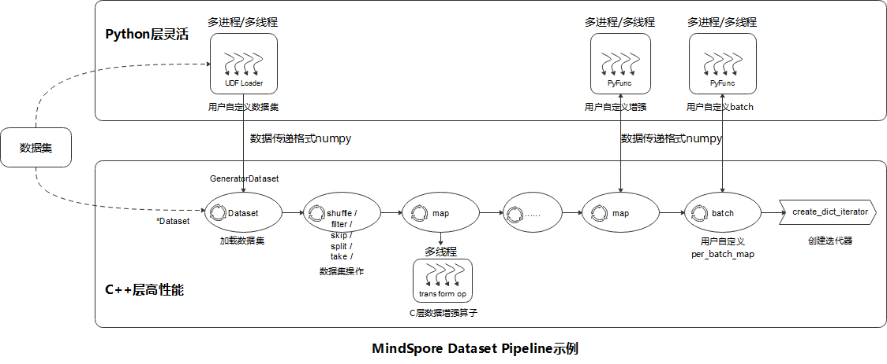

mindspore.dataset
==================

.. note::

    内置 ``mindspore.dataset.audio`` 模块及 CMUArctic、GTZAN、LibriTTS、LJSpeech、
    SpeechCommands、Tedlium、YesNo 七个数据集读取类已移除。
    音频输入可通过 :class:`mindspore.dataset.GeneratorDataset` 配合自定义读取器加载，
    并通过 :meth:`mindspore.dataset.Dataset.map` 执行自定义 Python 变换。
    这不是直接等价替换，迁移时需验证采样率、声道布局、数据类型、数据划分与采样规则及数值结果。
    MindRecord、DataLoader 和通用数据管线继续保留。

MindSpore的核心数据加载模块是Dataset，是一种基于Pipeline设计的 `数据引擎 <https://www.mindspore.cn/docs/zh-CN/master/features/data_engine.html>`_ 。

该模块提供了以下几种数据加载方式，帮助用户加载数据集到MindSpore中。

- 自定义数据集加载：允许用户通过Python定义 `可随机访问(Map-style)数据集 <https://www.mindspore.cn/tutorials/zh-CN/master/beginner/dataset.html#可随机访问数据集>`_
  和 `可迭代(Iterable-style)数据集 <https://www.mindspore.cn/tutorials/zh-CN/master/beginner/dataset.html#可迭代数据集>`_ 自定义数据读取、处理逻辑。
- 标准格式数据集加载：支持加载业界标准数据格式的数据集文件，包括 `MindRecord <https://www.mindspore.cn/tutorials/zh-CN/master/dataset/record.html>`_ 、`TFRecord <https://tensorflow.google.cn/tutorials/load_data/tfrecord.md?hl=zh-cn>`_ 等。
- 开源数据集加载：支持部分 `开源数据集 <#开源数据集加载>`_ 的解析读取，如MNIST、CIFAR-10、CLUE等。

此外，该模块也提供了对数据进行采样、增强变换、批处理等功能，以及随机种子、并行数等基础配置，与数据集加载API配合使用。

- 数据采样器：提供了多种常见 `采样器 <#采样器-1>`_ ，如RandomSampler、DistributedSampler等。
- 数据增强变换：提供了多种 `数据集操作 <https://www.mindspore.cn/docs/zh-CN/master/api_python/dataset/mindspore.dataset.GeneratorDataset.html#预处理操作>`_ ，以此对数据进行增强，批处理等。
- 基础配置：提供了 `Pipeline配置 <#配置>`_ 用于随机种子设置、并行数设置、数据恢复模式等功能。

常用数据集术语说明如下：

- Dataset，所有数据集的基类，提供了数据处理方法来帮助预处理数据。
- SourceDataset，一个抽象类，表示数据集管道的来源，从文件和数据库等数据源生成数据。
- MappableDataset，一个抽象类，表示支持随机访问的源数据集。
- Iterator，用于枚举元素的数据集迭代器的基类。

数据处理Pipeline介绍
--------------------

如上图所示，MindSpore Dataset模块使得用户很简便地定义数据预处理Pipeline，并以最高效（多进程/多线程）的方式处理
数据集中样本，具体的步骤参考如下：

- 加载数据集（Dataset）：用户可以方便地使用 Dataset类 ( `标准格式数据集 <https://www.mindspore.cn/docs/zh-CN/master/api_python/mindspore.dataset.loading.html#标准格式数据集加载>`_ 、
  `vision数据集 <https://www.mindspore.cn/docs/zh-CN/master/api_python/mindspore.dataset.loading.html#视觉数据集>`_ 、
  `nlp数据集 <https://www.mindspore.cn/docs/zh-CN/master/api_python/mindspore.dataset.loading.html#文本数据集>`_ ) 来加载已支持的数据集，
  或者使用 `自定义数据集加载 <https://www.mindspore.cn/docs/zh-CN/master/api_python/mindspore.dataset.loading.html#自定义数据集加载-1>`_ ，通过Python逻辑自定义数据集行为；

- 数据集操作（filter/ skip）：用户通过数据集对象方法 `.shuffle <https://www.mindspore.cn/docs/zh-CN/master/api_python/dataset/dataset_method/operation/mindspore.dataset.Dataset.shuffle.html#mindspore.dataset.Dataset.shuffle>`_ /
  `.filter <https://www.mindspore.cn/docs/zh-CN/master/api_python/dataset/dataset_method/operation/mindspore.dataset.Dataset.filter.html#mindspore.dataset.Dataset.filter>`_ /
  `.skip <https://www.mindspore.cn/docs/zh-CN/master/api_python/dataset/dataset_method/operation/mindspore.dataset.Dataset.skip.html#mindspore.dataset.Dataset.skip>`_ /
  `.split <https://www.mindspore.cn/docs/zh-CN/master/api_python/dataset/dataset_method/operation/mindspore.dataset.Dataset.split.html#mindspore.dataset.Dataset.split>`_ /
  `.take <https://www.mindspore.cn/docs/zh-CN/master/api_python/dataset/dataset_method/operation/mindspore.dataset.Dataset.take.html#mindspore.dataset.Dataset.take>`_ / … 来实现数据集的进一步混洗、过滤、跳过、最多获取条数等操作；

- 数据集样本变换操作（map）：用户可以将数据变换操作 （`vision数据变换 <https://www.mindspore.cn/docs/zh-CN/master/api_python/mindspore.dataset.transforms.html#视觉>`_ ，
  `nlp数据变换 <https://www.mindspore.cn/docs/zh-CN/master/api_python/mindspore.dataset.transforms.html#文本>`_ ）
  添加到 `.map <https://www.mindspore.cn/docs/zh-CN/master/api_python/dataset/dataset_method/operation/mindspore.dataset.Dataset.map.html>`_ 操作中执行，
  数据预处理过程中可以定义多个map操作，用于执行不同变换操作，数据变换操作也可以支持传入用户自定义Python函数 ；

- 批（batch）：用户在样本完成变换后，使用 `.batch <https://www.mindspore.cn/docs/zh-CN/master/api_python/dataset/dataset_method/batch/mindspore.dataset.Dataset.batch.html#mindspore.dataset.Dataset.batch>`_
  操作将多个样本组织成batch，也可以通过batch的参数 `per_batch_map` 来自定义batch逻辑；

- 迭代器（iterator）：最后用户通过数据集对象方法 `.create_dict_iterator <https://www.mindspore.cn/docs/zh-CN/master/api_python/dataset/dataset_method/iterator/mindspore.dataset.Dataset.create_dict_iterator.html>`_ /
  `.create_tuple_iterator <https://www.mindspore.cn/docs/zh-CN/master/api_python/dataset/dataset_method/iterator/mindspore.dataset.Dataset.create_tuple_iterator.html>`_ 来创建迭代器将预处理完成的数据循环输出。

数据处理Pipeline快速上手
-------------------------

如何快速使用Dataset Pipeline，可以将 `使用数据Pipeline加载 & 处理数据集 <https://www.mindspore.cn/docs/zh-CN/master/api_python/samples/dataset/dataset_gallery.html>`_ 下载到本地，按照顺序执行并观察输出结果。

自定义数据集加载
-----------------

.. mscnautosummary::
    :toctree: dataset
    :nosignatures:
    :template: classtemplate_inherited.rst

    mindspore.dataset.GeneratorDataset

标准格式数据集加载
-------------------

.. mscnautosummary::
    :toctree: dataset
    :nosignatures:
    :template: classtemplate_inherited.rst

    mindspore.dataset.MindDataset
    mindspore.dataset.OBSMindDataset
    mindspore.dataset.TFRecordDataset

开源数据集加载
---------------

视觉数据集
^^^^^^^^^^^

.. mscnautosummary::
    :toctree: dataset
    :nosignatures:
    :template: classtemplate_inherited.rst

    mindspore.dataset.Caltech101Dataset
    mindspore.dataset.Caltech256Dataset
    mindspore.dataset.CelebADataset
    mindspore.dataset.Cifar10Dataset
    mindspore.dataset.Cifar100Dataset
    mindspore.dataset.CityscapesDataset
    mindspore.dataset.CocoDataset
    mindspore.dataset.DIV2KDataset
    mindspore.dataset.EMnistDataset
    mindspore.dataset.FakeImageDataset
    mindspore.dataset.FashionMnistDataset
    mindspore.dataset.FlickrDataset
    mindspore.dataset.Flowers102Dataset
    mindspore.dataset.Food101Dataset
    mindspore.dataset.ImageFolderDataset
    mindspore.dataset.KITTIDataset
    mindspore.dataset.KMnistDataset
    mindspore.dataset.LFWDataset
    mindspore.dataset.LSUNDataset
    mindspore.dataset.ManifestDataset
    mindspore.dataset.MnistDataset
    mindspore.dataset.OmniglotDataset
    mindspore.dataset.PhotoTourDataset
    mindspore.dataset.Places365Dataset
    mindspore.dataset.QMnistDataset
    mindspore.dataset.RenderedSST2Dataset
    mindspore.dataset.SBDataset
    mindspore.dataset.SBUDataset
    mindspore.dataset.SemeionDataset
    mindspore.dataset.STL10Dataset
    mindspore.dataset.SUN397Dataset
    mindspore.dataset.SVHNDataset
    mindspore.dataset.USPSDataset
    mindspore.dataset.VOCDataset
    mindspore.dataset.WIDERFaceDataset

文本数据集
^^^^^^^^^^^

.. mscnautosummary::
    :toctree: dataset
    :nosignatures:
    :template: classtemplate_inherited.rst

    mindspore.dataset.AGNewsDataset
    mindspore.dataset.AmazonReviewDataset
    mindspore.dataset.CLUEDataset
    mindspore.dataset.CSVDataset
    mindspore.dataset.CoNLL2000Dataset
    mindspore.dataset.DBpediaDataset
    mindspore.dataset.EnWik9Dataset
    mindspore.dataset.IMDBDataset
    mindspore.dataset.IWSLT2016Dataset
    mindspore.dataset.IWSLT2017Dataset
    mindspore.dataset.Multi30kDataset
    mindspore.dataset.PennTreebankDataset
    mindspore.dataset.SogouNewsDataset
    mindspore.dataset.SQuADDataset
    mindspore.dataset.SST2Dataset
    mindspore.dataset.TextFileDataset
    mindspore.dataset.UDPOSDataset
    mindspore.dataset.WikiTextDataset
    mindspore.dataset.YahooAnswersDataset
    mindspore.dataset.YelpReviewDataset

其他数据集
----------

.. mscnautosummary::
    :toctree: dataset
    :nosignatures:
    :template: classtemplate_inherited.rst

    mindspore.dataset.NumpySlicesDataset
    mindspore.dataset.PaddedDataset
    mindspore.dataset.RandomDataset

采样器
-------

.. mscnautosummary::
    :toctree: dataset

    mindspore.dataset.DistributedSampler
    mindspore.dataset.PKSampler
    mindspore.dataset.RandomSampler
    mindspore.dataset.SequentialSampler
    mindspore.dataset.SubsetRandomSampler
    mindspore.dataset.SubsetSampler
    mindspore.dataset.WeightedRandomSampler

配置
-------

config模块能够设置或获取数据处理管道的全局配置参数。

.. mscnautosummary::
    :toctree: dataset

    mindspore.dataset.config.set_sending_batches
    mindspore.dataset.config.load
    mindspore.dataset.config.set_seed
    mindspore.dataset.config.get_seed
    mindspore.dataset.config.set_prefetch_size
    mindspore.dataset.config.get_prefetch_size
    mindspore.dataset.config.set_num_parallel_workers
    mindspore.dataset.config.get_num_parallel_workers
    mindspore.dataset.config.set_numa_enable
    mindspore.dataset.config.get_numa_enable
    mindspore.dataset.config.set_monitor_sampling_interval
    mindspore.dataset.config.get_monitor_sampling_interval
    mindspore.dataset.config.set_callback_timeout
    mindspore.dataset.config.get_callback_timeout
    mindspore.dataset.config.set_auto_num_workers
    mindspore.dataset.config.get_auto_num_workers
    mindspore.dataset.config.set_enable_shared_mem
    mindspore.dataset.config.get_enable_shared_mem
    mindspore.dataset.config.set_enable_autotune
    mindspore.dataset.config.get_enable_autotune
    mindspore.dataset.config.set_autotune_interval
    mindspore.dataset.config.get_autotune_interval
    mindspore.dataset.config.set_auto_offload
    mindspore.dataset.config.get_auto_offload
    mindspore.dataset.config.set_enable_watchdog
    mindspore.dataset.config.get_enable_watchdog
    mindspore.dataset.config.set_fast_recovery
    mindspore.dataset.config.get_fast_recovery
    mindspore.dataset.config.set_multiprocessing_timeout_interval
    mindspore.dataset.config.get_multiprocessing_timeout_interval
    mindspore.dataset.config.set_error_samples_mode
    mindspore.dataset.config.get_error_samples_mode
    mindspore.dataset.config.ErrorSamplesMode
    mindspore.dataset.config.set_debug_mode
    mindspore.dataset.config.get_debug_mode
    mindspore.dataset.config.set_multiprocessing_start_method
    mindspore.dataset.config.get_multiprocessing_start_method
    mindspore.dataset.config.set_video_backend
    mindspore.dataset.config.get_video_backend

工具
-----

.. mscnautosummary::
    :toctree: dataset
    :nosignatures:
    :template: classtemplate_inherited.rst

    mindspore.dataset.BatchInfo
    mindspore.dataset.DatasetCache
    mindspore.dataset.DSCallback
    mindspore.dataset.Schema
    mindspore.dataset.Shuffle
    mindspore.dataset.WaitedDSCallback
    mindspore.dataset.compare
    mindspore.dataset.debug.DebugHook
    mindspore.dataset.deserialize
    mindspore.dataset.serialize
    mindspore.dataset.show
    mindspore.dataset.utils.imshow_det_bbox
    mindspore.dataset.utils.LineReader
